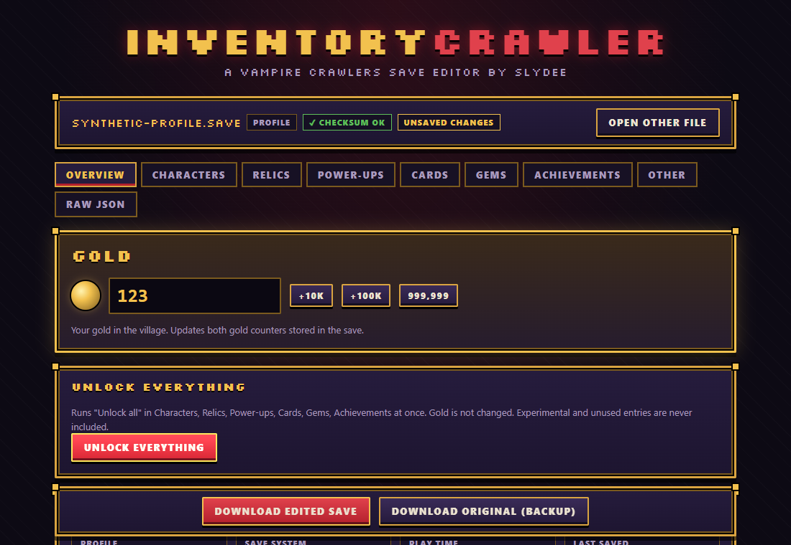
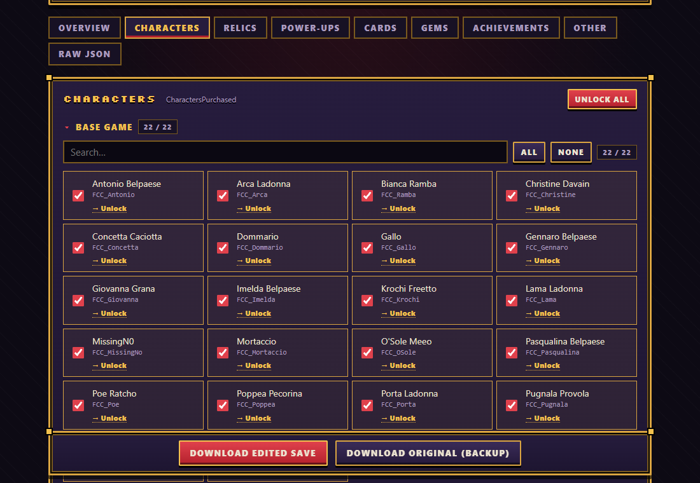
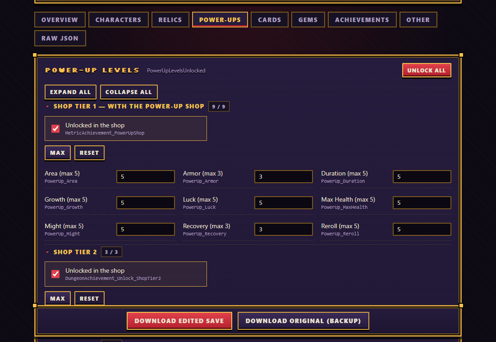
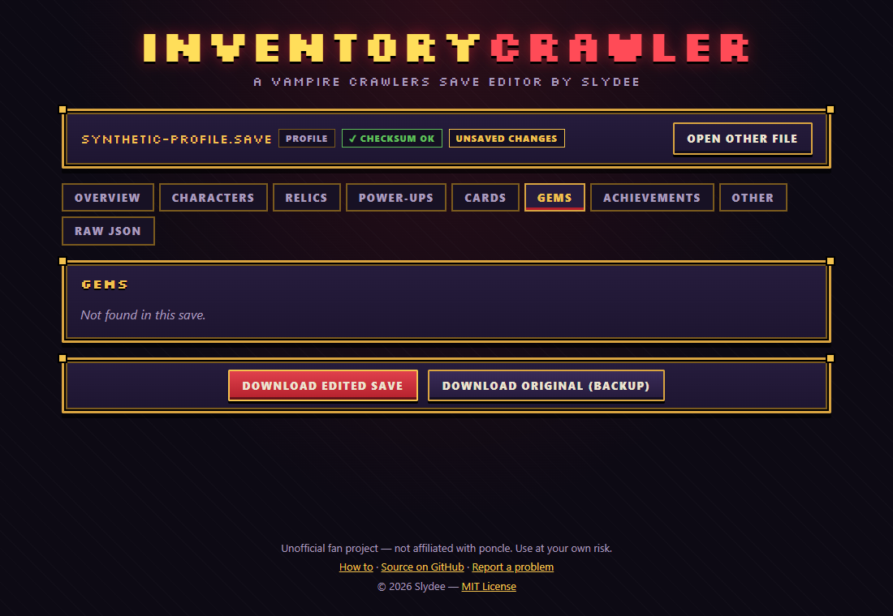
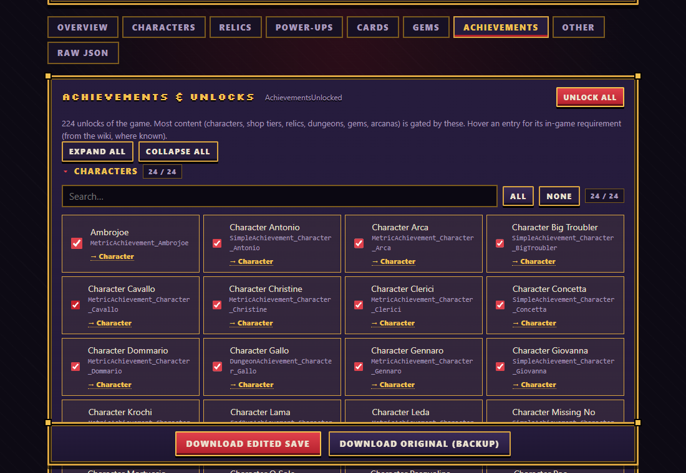

# InventoryCrawler — A Vampire Crawlers Save Editor

Edit your *Vampire Crawlers* save files right in your browser. Nothing is uploaded — the file never leaves your device.

**▶ Open the editor: https://slydee23.github.io/inventory-crawler/**
**📖 Where are my save files? → [How to](https://slydee23.github.io/inventory-crawler/howto.html)**



## Features

- **Gold** — set any amount (both gold counters in the save are kept in sync).
- **Characters** — unlock and buy any of the 25 Crawlers, grouped by base game and Death Parade update.
- **Relics** — unlock and enable all relics, grouped by where they come from.
- **Power-ups** — unlock every shop tier and set levels up to their real in-game maximum.
- **Cards** — all 107 cards by type (Attack, Defense, Stat boost, Mana, Pickups, Debuff, Crawler cards), plus **gem slots per card** up to each card's Blacksmith maximum.
- **Gems** — unlock gems, change their rarity and seal (ban) them, like the Jeweller in-game.
- **Achievements & unlocks** — all 224 unlocks of the game, each showing what it unlocks and its in-game requirement.
- **Unlock everything** — one button for all of the above (gold and gem slots stay untouched).
- **Settings** — volumes and options from `SettingsData.save`.
- **Raw JSON** — everything else, for experts.
- Linked entries: jump from a character, relic, card or gem to its unlock and back.
- Safe by design: the checksum is recalculated on download, the original can be downloaded as a backup, and unknown data is preserved byte-for-byte.

| Characters | Power-ups |
|---|---|
|  |  |
| **Gems** | **Achievements** |
|  |  |

## How to use

1. Close the game completely.
2. Copy `SaveProfile0.save` from the game's save folder (see the [How to](https://slydee23.github.io/inventory-crawler/howto.html) page):
   - Android: `Android/data/com.poncle.vampirecrawlers/files/Save/`
   - PC (Steam): `%USERPROFILE%\AppData\LocalLow\Nosebleed Interactive\Vampire Crawlers\Save\`
3. Open it in the editor, **download the original as a backup**, make your changes, download the edited save.
4. Make sure the file is named exactly `SaveProfile0.save`, copy it back and start the game.

Tested with game version **1.6.5** (save format `0.30.0`) on Android, including a save with everything unlocked. Saves from other versions show a warning — keep a backup.

## Privacy

The editor is a static web page. Your save is read and written locally in your browser; no data is sent anywhere and there is no tracking.

## How it works

The save is JSON with a SHA-1 checksum over its data block. The editor parses it losslessly (keeping key order and number formatting exactly as the game writes them) and recalculates the checksum on export — a save that is loaded and downloaded unchanged is byte-identical to the original.

Which unlock gates which content, item names, maximum levels and gem slots were read from the game data and verified against real saves and in-game tests. Details: [docs/SAVE_FORMAT.md](docs/SAVE_FORMAT.md).

## Development

Plain HTML/CSS/JavaScript, no build step, no dependencies. Node.js is only used for tests and tools.

```sh
node --test tests/                     # tests (round-trips real saves found in "VC Save/" or "samples/")
node tools/stamp-version.mjs           # cache-busting version stamp — run before every commit
node --max-old-space-size=6000 tools/extract-apk-ids.mjs <game.apk> --write   # refresh game data after an update
```

Game files and real saves are never committed (see `.gitignore`). Project notes: [CLAUDE.md](CLAUDE.md), progress: [PLAN.md](PLAN.md).

## Credits

- Unlock requirements and names: [Vampire Survivors Wiki](https://vampire.survivors.wiki/w/Crawlers:Unlocks) (CC BY-SA).
- Pixel font: [Silkscreen](https://github.com/googlefonts/silkscreen) by Jason Kottke, SIL Open Font License 1.1 (`fonts/OFL.txt`).

## Disclaimer

Unofficial fan project, not affiliated with or endorsed by poncle or Nosebleed Interactive. *Vampire Crawlers* and all related names belong to their owners. Editing save files is at your own risk — always keep a backup.

## License

[MIT](LICENSE) © 2026 Slydee. The pixel font is licensed separately under the SIL OFL 1.1.
